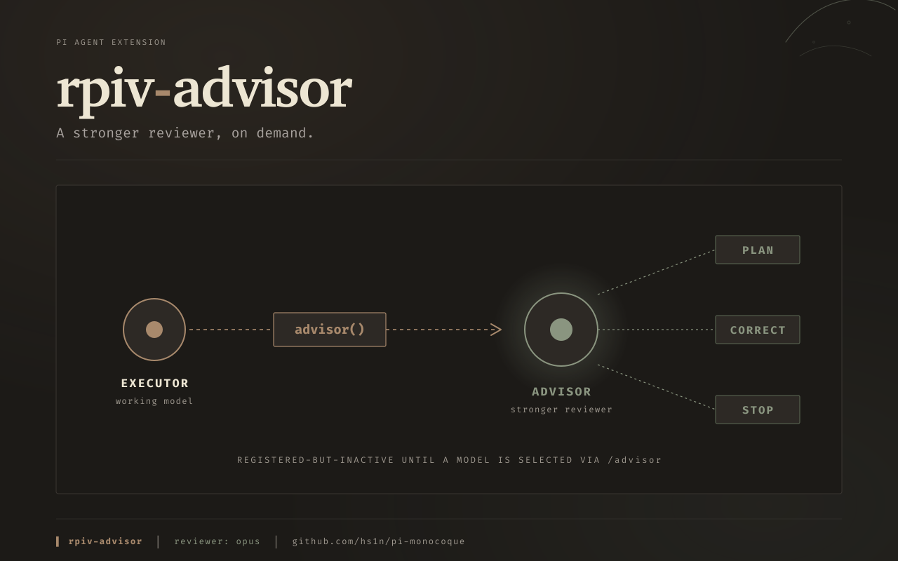

# @hs1n/rpiv-advisor

<div align="center">
  <a href="https://github.com/hs1n/pi-monocoque/tree/main/packages/rpiv-advisor">
    <picture>
      
    </picture>
  </a>
</div>

Your working model can send its full conversation to a second, stronger model. The stronger
model sends back a plan, a correction or a stop signal, and the work continues. `rpiv-advisor`
adds the `advisor` tool (no parameters) and the `/advisor` command to
[Pi Agent](https://github.com/badlogic/pi-mono). Thus you can use a fast model and keep a
stronger reviewer one call away.

## Install

This package is in [`hs1n/pi-monocoque`](https://github.com/hs1n/pi-monocoque), an 11-package
monorepo. Nothing is published to npm. Install the repo as a Pi source:

```sh
pi install git:github.com/hs1n/pi-monocoque
```

Restart Pi, or run `/reload` in a running session. The `Agent` tool of the pipeline comes from
a third-party package. Install it separately:

```sh
pi install npm:@tintinweb/pi-subagents@0.26.3
```

[INSTALL-FORK.md](https://github.com/hs1n/pi-monocoque/blob/main/INSTALL-FORK.md) gives the
live-checkout install (`pi install <path>`) and `scripts/fork-pi-install.sh` (one Pi entry per package).

## Quick start

The advisor does nothing until you select a reviewer. Run:

```
/advisor
```

A picker shows each model that Pi has credentials for. Type to filter by model name, provider
or `provider/id`. Select a model. If the model supports reasoning, a second picker shows its
effort levels (`high` is recommended). Pi shows `Advisor: <model>, <effort>`. The `advisor` tool
is then live for this session and for all future sessions.

If a model is not in the list, its provider is not authenticated. Run the Pi `/login` command
for that provider, then run `/advisor` again.


The executor model then calls `advisor()` itself when it needs better judgment. To turn the
advisor off, run `/advisor off`, or run `/advisor` and select **No advisor**.

You can also set the advisor with arguments, with or without a UI:

| Command | What it does |
| --- | --- |
| `/advisor <provider>/<model-id> [effort]` | Sets the reviewer. `[effort]` is `off` or a level that the model supports. No effort and `off` save the same state: the advisor sends no reasoning option. For a model with no reasoning, the command rejects each effort, `off` too |
| `/advisor off` | Turns the advisor off |
| `/advisor` with no UI | Shows the current setting and the usage |

If an argument is not valid, the command shows an error, and it changes nothing. An unknown
model or effort error also lists the valid values. In print mode (`pi -p`), Pi discards notify
messages. Thus the command applies valid arguments but shows no output. RPC clients get the output.

## What you get

- **A second opinion in the same session**: the executor calls `advisor()` during a turn. It
  reads the answer as the tool result and continues. Nothing goes into your transcript. The
  default prompt guidelines tell the executor to repeat the key guidance in its next visible
  reply. Thus you see more than a collapsed tool card.
- **Nothing to type or paste**: the tool has no parameters. It serializes and sends the full
  conversation branch: the task, each tool call and each result. Each call bills that full
  branch to the reviewer model, so each call has a cost.
- **The reviewer sees the context after compaction**: the extension builds the branch from the
  resolved LLM context of Pi. Thus it sends compaction and branch summaries, not an old raw
  replay.
- **Any model can be the reviewer**: each model that you are authenticated for is in the
  `/advisor` picker, and fuzzy typing finds it. No provider has priority.
- **Your selection stays**: the extension saves the model and effort to `advisor.json`, and
  applies them again at each session start.
- **Skip it when you already use a strong model**: list executor models in
  `disabledForModels` to remove the tool for them. You can also remove it only at or above an
  effort level. The extension removes and adds the tool live when you change model or effort.
- **Off costs nothing**: with no model selected, the extension removes the tool from the active
  set. Thus its prompt text does not go into the system prompt.

## Configuration

The settings are in `~/.config/rpiv-advisor/advisor.json`. If `$XDG_CONFIG_HOME` is an
absolute path, the file is `$XDG_CONFIG_HOME/rpiv-advisor/advisor.json`. `/advisor` creates
the file and sets its mode to `0600`. If a write fails, your previous selection stays, and the
command tells you.

| Key | What it does | Default |
| --- | --- | --- |
| `modelKey` | The reviewer model, as `"provider/modelId"`. `/advisor` writes it. | absent: advisor off |
| `effort` | Reasoning effort for the reviewer: `minimal`, `low`, `medium`, `high`, `xhigh`, `max`. `/advisor` writes it and offers only the levels that the model supports. | absent: no reasoning sent |
| `disabledForModels` | Executor models that do not get the tool. A plain string blocks at all efforts. `{ "model": "…", "minEffort": "…" }` blocks only at or above that effort. | `[]` |

```json
{
  "modelKey": "anthropic/claude-opus-4-5",
  "effort": "high",
  "disabledForModels": [
    "anthropic/claude-opus-4-5",
    { "model": "openai/gpt-5.2", "minEffort": "high" }
  ]
}
```

`/advisor` writes only `modelKey` and `effort`. Thus the keys that you edit by hand
(`disabledForModels` and the `guidance` overrides) stay after each save.

## Reference

- [Configuration](https://github.com/hs1n/pi-monocoque/blob/main/packages/rpiv-advisor/docs/configuration.md): config file resolution, each key, blocklist rules, guidance overrides and all notifications.
- [`advisor` tool reference](https://github.com/hs1n/pi-monocoque/blob/main/packages/rpiv-advisor/docs/tool-reference.md): schema, result envelope, failure paths, the data sent to the reviewer, lifecycle hooks and picker keys.

## Requirements

- A [Pi Agent](https://github.com/badlogic/pi-mono) host. The extension loads through the
  Pi extension manifest. It has no native dependencies.
- An authenticated provider for the **reviewer** model, through the Pi model registry.

## Troubleshooting

| Symptom | Cause | Fix |
| --- | --- | --- |
| The `/advisor` picker shows only **No advisor** | No provider is authenticated in Pi | Run the Pi `/login` command for a provider, then run `/advisor` again |
| The tool result is `Advisor (<model>) has no API key available.` | Pi cannot find the credentials for the provider of the reviewer | Authenticate that provider again with `/login` |

## Related

- [`@hs1n/rpiv-pi`](https://github.com/hs1n/pi-monocoque/tree/main/packages/rpiv-pi): the
  umbrella package. Its `code-review` skill calls `advisor()` when this package is installed.

## License

MIT. See [LICENSE](https://github.com/hs1n/pi-monocoque/blob/main/packages/rpiv-advisor/LICENSE).
