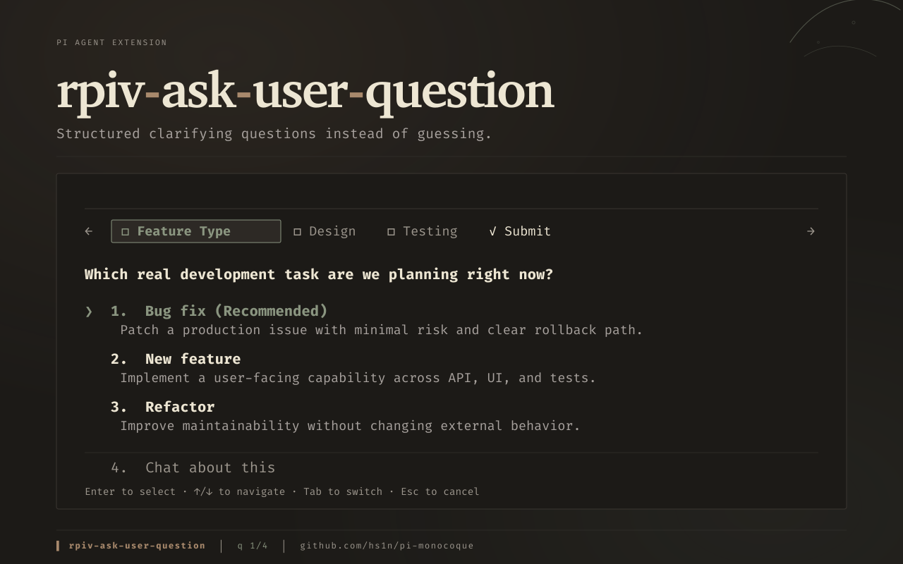

# @hs1n/rpiv-ask-user-question

<div align="center">
  <a href="https://github.com/hs1n/pi-monocoque/tree/main/packages/rpiv-ask-user-question">
    
  </a>
</div>

The model asks you, and does not guess. This extension gives [Pi Agent](https://github.com/badlogic/pi-mono) one tool, `ask_user_question`. The tool opens a terminal dialog with a maximum of four questions and written options. It sends your choices back as structured data. Install it if you prefer fifteen seconds of selection to an hour of work on a wrong assumption.

## Install

This package is in [`hs1n/pi-monocoque`](https://github.com/hs1n/pi-monocoque), an 11-package
monorepo. Nothing is published to npm. Install the repo as a Pi source:

```sh
pi install git:github.com/hs1n/pi-monocoque
```

Restart Pi, or run `/reload` in a running session. The `Agent` tool of the pipeline comes from
a third-party package. Install it separately:

```sh
pi install npm:@tintinweb/pi-subagents@0.26.3
```

[INSTALL-FORK.md](https://github.com/hs1n/pi-monocoque/blob/main/INSTALL-FORK.md) gives the
live-checkout install (`pi install <path>`) and `scripts/fork-pi-install.sh` (one package at a time).

## Quick start

You do not need to set anything up. The tool is live when Pi restarts. Give the model a task that contains a real decision:

> Add caching to the API client.

The model does not select a strategy for you. It calls `ask_user_question`, and a dialog opens at the bottom of your terminal. These are the keys:

| Key | What it does |
| --- | --- |
| `↑` / `↓` | Move between options |
| `Enter` | Select an option |
| `n` | Add a note to a question, or a global note on the Submit tab |
| `Type something.` row | Answer in your own words |
| `Shift+Enter` | Add a line while you type |
| `Ctrl+G` | Open the external editor that is configured in Pi |
| `Ctrl+U` | Clear the draft |
| `Esc` | Stop the questionnaire |

In a multi-select question, the dialog selects your custom text automatically and sends it with the checked options. If you go to a different option and come back, your text stays.

When the questionnaire starts to wait in an interactive TTY, it sends one standard terminal BEL (`\x07`). Your terminal configuration sets whether that is an audible alert, a visual alert or nothing. Redirected output and non-TTY output do not change.


When the model asks more than one question, `Tab` moves between them. A Submit tab shows all your answers before they go back:


## What you get

- **Typed options, not long prose**: each question has 2-4 written choices. Each choice has a description of what it means or what it costs.
- **You can always answer in your own words**: each question has a `Type something.` row at the end. In multi-select questions, this row keeps the checked options and the custom text in the same answer. The row uses the full pane width while you type. Your multiline draft stays visible while you look at other options. The row supports the Pi `Shift+Enter` newline and the `Ctrl+G` external editor.
- **Compare real artifacts, not only labels**: an option can have a Markdown `preview` (ASCII mockup, code, diagram or config). The preview shows in a box beside the option list.
- **One interruption, not five**: a maximum of four questions come in one dialog with tabs. Before you submit, the Submit tab lists your answers and names each blank question.
- **Notes on one answer or on all answers**: on a question tab, `n` opens a multiline note editor. On the Submit tab, it opens one global note for the full questionnaire. The model gets a question note as `user notes: <text>` and the global note as `global note: <text>`. A note does not mark a question as answered.
- **Read while you answer**: the question opens below the transcript. `PageUp`/`PageDown` and the mouse wheel scroll the conversation. `Ctrl+]` makes the dialog one line high when you need more space. The same key opens it again, and your answers stay.
- **It also works outside the terminal**: RPC and ACP hosts include the VS Code pendant and Zed. In these hosts, the questionnaire uses the native dialogs of the host. Notes work only in the terminal. In non-interactive runs, the extension removes the tool from the tool list of the model, so no call fails.

## Configuration

This is optional. The settings are in `~/.config/rpiv-ask-user-question/config.json`. The extension reads the file and never writes it.

| Setting | What it does | Default |
| --- | --- | --- |
| `collapseKey` | The key that collapses and expands the dialog. It accepts Pi keybinding ids such as `alt+o`. `"off"` turns off the shortcut. | `"ctrl+]"` |
| `guidance.description` | A full replacement for the tool description that the model sees. A non-empty string replaces all the built-in text. There is no merge. | built-in description |
| `guidance.promptSnippet` | The one-line description of the tool in the system prompt. Use it to change how often the model asks. | built-in snippet |
| `guidance.promptGuidelines` | Usage guidelines for the model, as a list of strings. | 4 built-in guidelines |

```json
{ "collapseKey": "alt+o" }
```

If the JSON is malformed, the extension uses the defaults and shows a warning. If one value is not usable, the extension uses its default with no message. It never shows an error.

## Reference

- [Tool schema](https://github.com/hs1n/pi-monocoque/blob/main/packages/rpiv-ask-user-question/docs/tool-schema.md): parameters, limits, reserved labels, validation errors, the result envelope and the `rpiv:ask-user:prompt` event.
- [Keyboard and layout](https://github.com/hs1n/pi-monocoque/blob/main/packages/rpiv-ask-user-question/docs/keyboard.md): each key, the rows that the dialog adds, notes, collapse mode, and how previews and overflow change with the terminal size.
- [Configuration](https://github.com/hs1n/pi-monocoque/blob/main/packages/rpiv-ask-user-question/docs/configuration.md): file lookup and `XDG_CONFIG_HOME`, the `collapseKey` grammar, the `guidance.*` prompt overrides, and invalid values.
- [Hosts and runtime behavior](https://github.com/hs1n/pi-monocoque/blob/main/packages/rpiv-ask-user-question/docs/hosts.md): terminal, RPC and non-interactive runs, what each one cannot do, and the load-failure envelopes.
- [Localization](https://github.com/hs1n/pi-monocoque/blob/main/packages/rpiv-ask-user-question/docs/localization.md): the ten shipped languages, how the extension selects the locale, and how to add one.

## Requirements

- Node.js 22 or newer.
- Pi Agent, with an interactive terminal or an RPC/ACP host. Non-interactive runs do not get the tool.
- A terminal with a minimum width of 100 columns for previews beside the options. In a narrower terminal, the preview shows under the options.

The extension has no native dependencies, needs no compiler and no API keys, and makes no model calls.

## Troubleshooting

**The model says that the questionnaire UI did not load, and it asks its questions as chat text.** Something replaced the modules of the dialog on disk while Pi was running. Usually, a package-manager install changed the store. If the install is broken, repair it. Then restart Pi. The running process cannot recover from this failure.

**`Ctrl+]` does nothing.** On some keyboard layouts, such as Latin American, `]` needs the Shift key, so you cannot type the default. Set `collapseKey` to a key that you can type, for example `"alt+o"`.

## Related

- [`@hs1n/rpiv-i18n`](https://github.com/hs1n/pi-monocoque/tree/main/packages/rpiv-i18n): optional. When it is installed, the dialog text shows in your language, and you get `/languages`.
- [`@hs1n/rpiv-pi`](https://github.com/hs1n/pi-monocoque/tree/main/packages/rpiv-pi): the umbrella package. Its pipeline skills use `ask_user_question` as the developer checkpoint. `/rpiv-setup` offers to install this extension.

## License

MIT. See [LICENSE](https://github.com/hs1n/pi-monocoque/blob/main/packages/rpiv-ask-user-question/LICENSE).
