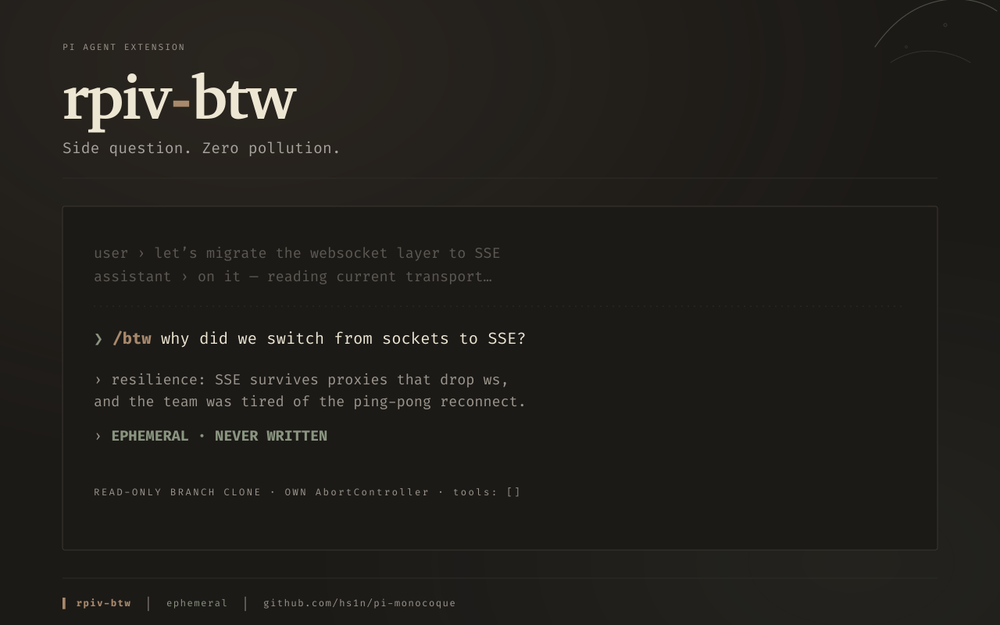

# @hs1n/rpiv-btw

<div align="center">
  <a href="https://github.com/hs1n/pi-monocoque/tree/main/packages/rpiv-btw">
    
  </a>
</div>

Ask a side question, and keep it out of the main conversation. `rpiv-btw` adds
`/btw <question>` to [Pi Agent](https://github.com/badlogic/pi-mono). Your primary model
answers in a panel at the bottom of the terminal. It uses a read-only clone of the current
conversation as context. The answer does not go into the transcript, and nothing goes to disk.

## Install

`rpiv-btw` is **opt-in**. It is not in the root `pi` manifest of the monorepo, so
`pi install git:github.com/hs1n/pi-monocoque` does **not** load it. Clone the repo, then add
btw by its local path:

```sh
git clone git@github.com:hs1n/pi-monocoque ~/src/pi-monocoque
cd ~/src/pi-monocoque && npm install
scripts/fork-pi-install.sh --with btw
```

Restart Pi, or run `/reload` in a running session. An install of one package records the path,
and does not copy the files. Thus, keep the checkout where it is.

## Quick start

Type `/btw` and then your question:

```
/btw why did we switch from sockets to SSE last week?
```

A panel opens at the bottom of the terminal. A banner shows your question. A `…` shows while
the model works, and then the answer shows. The panel lists the previous `/btw` questions of
this session under the banner, so follow-up questions have context.

`/btw` uses the model of your session, so you do not select a model. Pi needs an active model
with credentials that work (`/login`).


| Key | Action |
| --- | --- |
| `↑` / `↓` | Scroll the panel when the content is too long. The hint shows after the answer arrives |
| `x` | Clear the `/btw` history of this session. The hint shows only when you have previous entries |
| `Esc` | Close the panel. If the call still runs, this cancels it |

## What you get

- **Nothing goes into the main chat**: the answer shows in an overlay. It is not an agent
  message, and it is not written to the transcript or to disk.
- **The side question knows your work**: it gets a read-only clone of the current context of
  the main agent. You do not need to explain the context again.
- **Follow-up questions have their own thread**: each `/btw` turn in a session goes into the
  next one. Thus the side conversation remembers its own history.
- **`Esc` cancels only the side question**: it does not stop the work of the main session.
- **The history stays after `/new`, `/fork`, `/resume` and `/reload`**: the running Pi process
  holds it. The history clears when Pi stops.
- **Correct after compaction**: the clone is the compacted context that the main agent sees,
  not the full history. The extension builds it again after each compaction or branch change.
  Thus a later `/btw` does not use an old view.
- **No tools, plain text only**: a side question cannot edit a file or run a command.

## Reference

- [Context model](https://github.com/hs1n/pi-monocoque/blob/main/packages/rpiv-btw/docs/context-model.md):
  what each `/btw` call sends to the model. This includes the context snapshot and its
  invalidation rules, the session history, the cross-session question hint and the
  no-pollution guarantees.
- [Architecture](https://github.com/hs1n/pi-monocoque/blob/main/packages/rpiv-btw/docs/architecture.md):
  modules, the registered command and hooks, overlay layout and key handling, process-scoped
  state, Pi host-version tolerance and the full list of error messages.

## Requirements

- **An interactive terminal.** `/btw` does not run without a UI. It is not available in
  `pi --print` or RPC.
- **An active primary model with credentials that resolve.** All providers work.

## Troubleshooting

| Symptom | Cause | Fix |
| --- | --- | --- |
| `/btw requires interactive mode` | Pi runs in `pi --print …` or RPC | Run Pi interactively |
| `/btw requires an active model` | No primary model is configured | Set one with `/login`, or edit the Pi file `~/.pi/agent/models.json` |
| `/btw model (…) has no API key available.` | The credentials for the active model do not resolve | Authenticate that provider again |
| `Usage: /btw <question>` | `/btw` ran with no argument | Put the question on the same line |
| `X` does nothing | Only lowercase `x` clears the history | Push `x` |
| The history is gone after a Pi restart | This is the design. The state is in the process and is not written to disk | No fix is necessary. Your main session does not change |

## Related

- [`@hs1n/rpiv-pi`](https://github.com/hs1n/pi-monocoque/tree/main/packages/rpiv-pi): the
  umbrella package. It does not install `rpiv-btw`. Install this package yourself if you want
  `/btw`.
- [pi-monocoque](https://github.com/hs1n/pi-monocoque#readme): the other rpiv packages.

## License

MIT. See [LICENSE](LICENSE).
