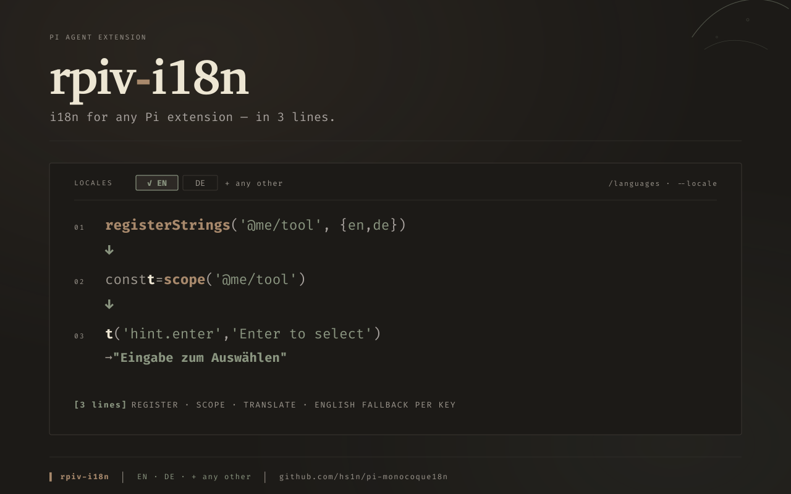

# @hs1n/rpiv-i18n

<div align="center">
  <a href="https://github.com/hs1n/pi-monocoque/tree/main/packages/rpiv-i18n">
    
  </a>
</div>

Select the language of all rpiv-\* extensions in your [Pi Agent](https://github.com/badlogic/pi-mono)
terminal. This extension adds the `/languages` command and a `--locale` flag, and it keeps your
selection between sessions. It is also an SDK for Pi extension authors. With three lines, you
can make your own TUI strings translatable, with an English fallback for each key.

## Install

This package is in [`hs1n/pi-monocoque`](https://github.com/hs1n/pi-monocoque), an 11-package
monorepo. Nothing is published to npm. Install the repo as a Pi source:

```sh
pi install git:github.com/hs1n/pi-monocoque
```

Restart Pi, or run `/reload` in a running session. The `Agent` tool of the pipeline comes from
a third-party package. Install it separately:

```sh
pi install npm:@tintinweb/pi-subagents@0.26.3
```

[INSTALL-FORK.md](https://github.com/hs1n/pi-monocoque/blob/main/INSTALL-FORK.md) gives the
live-checkout install (`pi install <path>`) and `scripts/fork-pi-install.sh` (one package at a time).

## Quick start

Open the picker and select a language:

```
/languages
```

The arrow keys move, `Enter` selects and `Esc` cancels. A `✓` marks your current selection. The
**System default** row gives control back to your environment. When you select, each installed
extension that uses the SDK shows the new language immediately. You do not need to restart.

To set the language with no picker, give the code: `/languages uk`. To clear the setting, run
`/languages system`. Codes are case-sensitive. To set it for one launch only, use the flag:

```sh
pi --locale uk
```

| Code | Language | Code | Language |
| --- | --- | --- | --- |
| `de` | Deutsch | `pt-BR` | Português (Brasil) |
| `en` | English | `ru` | Русский |
| `es` | Español | `uk` | Українська |
| `fr` | Français | `zh` | 简体中文 |
| `pt` | Português | `zh-TW` | 繁體中文 |

To localize your own extension, add `@hs1n/rpiv-i18n` to your `peerDependencies` (marked
optional). Then, at extension load:

```ts
import { scope } from "@hs1n/rpiv-i18n";
import { registerLocalesFromDir } from "@hs1n/rpiv-i18n/loader";

registerLocalesFromDir("@my-org/cool-tool", import.meta.url);
export const t = scope("@my-org/cool-tool");
// then t("welcome.title", "Welcome") at every render site
```

Put both imports in the dynamic-import shim from the integration guide below. Then your
extension continues to work in English when the SDK is not installed.

## What you get

- **One setting for all extensions**: `/languages` writes one preference. It rebuilds the
  strings of all registered packages at the same time. You do not need one setting per tool.
- **Ten languages, no file edits**: the extension ships each locale in the table above. You
  do not download, compile or configure anything.
- **A localized UI with no setup on most Unix systems**: the extension reads `LANG` and
  `LC_ALL` at startup. Thus `uk_UA.UTF-8` gives you a Ukrainian UI before you change anything.
- **Your selection cannot change back without a message**: the picker writes to disk *before*
  it applies the change in memory. If the write fails, you get
  `Failed to save locale preference — selection not persisted`, and the old locale stays.
- **Localize your own extension with one call**: `registerLocalesFromDir` reads the
  `locales/*.json` files of your package. `scope(ns)` gives you `t(key, fallback)`.
- **A broken translation never stops an extension**: the extension skips a locale file that
  it cannot parse, and shows a warning. A missing key falls back to English. If a key is
  missing in all files, `t` returns the English text that you gave at the call site.
- **Only the TUI is translated**: system prompts, tool descriptions and other text for the
  LLM stay in English on purpose. Thus your locale does not change the behavior of the model.

## Configuration

The extension stores your selection at `$XDG_CONFIG_HOME/rpiv-i18n/locale.json`. The default
is `~/.config/rpiv-i18n/locale.json`. The extension creates the file with mode `0600`. The file
holds exactly one key:

| Key | What it does | Default |
| --- | --- | --- |
| `locale` | The UI locale code, for example `"uk"`. When you select **System default**, the file does not have this key. | absent: environment detection, then English |

```json
{ "locale": "uk" }
```

| Surface | Effect |
| --- | --- |
| `/languages` | Opens the picker. With no UI, it shows the current locale and the usage. |
| `/languages <code>` | Sets the locale. If the code is not valid, it shows an error that lists the valid values, and it changes nothing. |
| `/languages system` | Clears the setting, as **System default** does. |
| `--locale <code>` | Sets the locale for that session. It has priority over the config file. |
| `LANG`, `LC_ALL` | Used when no locale is configured. The language comes from `<lang>_<REGION>.<charset>`. The extension ignores `C` and `POSIX`. |
| `XDG_CONFIG_HOME` | Moves the config directory. It must be an absolute path or start with `~`, as the XDG spec requires. |

Resolution order: `--locale` → config file → `LANG` → `LC_ALL` → English.

In print mode (`pi -p`), Pi discards notify messages. Thus `/languages <code>` applies a valid
code but shows no output. RPC clients get the output.

## Reference

- [SDK reference](https://github.com/hs1n/pi-monocoque/blob/main/packages/rpiv-i18n/docs/sdk-reference.md):
  each export from `@hs1n/rpiv-i18n` and `/loader`, the fallback contract, the detection chain
  and the `globalThis` escape hatch.
- [Integration guide](https://github.com/hs1n/pi-monocoque/blob/main/packages/rpiv-i18n/docs/integration-guide.md):
  the steps to localize your own Pi extension, from the optional peer dependency to a live
  smoke test.
- [Contributing translations](https://github.com/hs1n/pi-monocoque/blob/main/packages/rpiv-i18n/docs/translating.md):
  what to translate, key names, file shape and the PR checklist.

## Requirements

You need no API keys, no network access and no native dependencies. The `0600` permission bit
and the `LANG`/`LC_ALL` detection are Unix conventions. They are not tested on Windows.

## Related

- [@hs1n/rpiv-pi](https://github.com/hs1n/pi-monocoque/tree/main/packages/rpiv-pi): the
  umbrella package. Its `/rpiv-setup` command installs this package for you.
- [@hs1n/rpiv-todo](https://github.com/hs1n/pi-monocoque/tree/main/packages/rpiv-todo) and
  [@hs1n/rpiv-ask-user-question](https://github.com/hs1n/pi-monocoque/tree/main/packages/rpiv-ask-user-question):
  extensions that use your `/languages` selection. Each one treats this package as an optional
  peer, and works in English without it.

## License

MIT. See [LICENSE](LICENSE).
