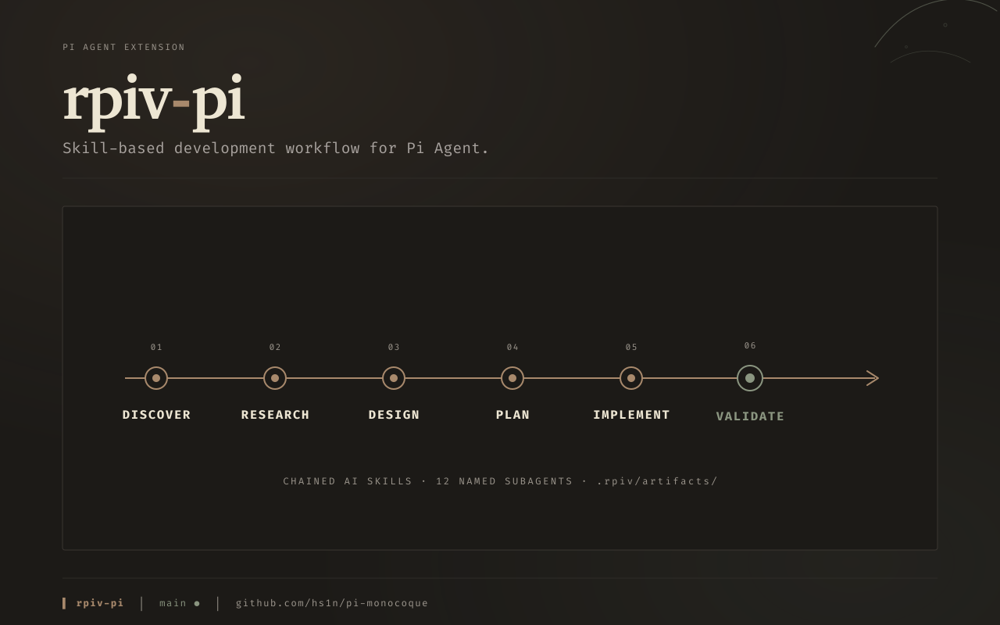

# @hs1n/rpiv-pi

[](https://github.com/hs1n/pi-monocoque/tree/main/packages/rpiv-pi)
[](https://opensource.org/licenses/MIT)

<div align="center">
  <a href="https://github.com/hs1n/pi-monocoque/tree/main/packages/rpiv-pi">
    
  </a>
</div>

Turn "build this feature" into a run of named stages — discover → research → design →
plan → implement → validate → code-review → commit — each one writing a reviewable
Markdown artifact under `.rpiv/artifacts/` that the next stage consumes. rpiv-pi adds 29
skills and 15 specialist subagents to [Pi Agent](https://github.com/badlogic/pi-mono), and
lets the agent orchestrate them with Pi's own `Agent` and `SubagentWorkflow` tools. It is
for developers who want structured, reviewable multi-stage work instead of one very long
chat turn.

## Install

`rpiv-pi` ships inside [`hs1n/pi-monocoque`](https://github.com/hs1n/pi-monocoque), a
11-package monorepo with **no registry route** — there is no `@hs1n/rpiv-*` entry on npm.
Install the repo as a Pi source:

```sh
pi install git:github.com/hs1n/pi-monocoque
```

Restart Pi, or `/reload` in a running session. The pipeline's `Agent` tool comes from a
third-party package and is installed separately:

```sh
pi install npm:@tintinweb/pi-subagents@0.21.0
```

[INSTALL-FORK.md](https://github.com/hs1n/pi-monocoque/blob/main/INSTALL-FORK.md) covers the
live-checkout install (`pi install <path>`, edits picked up by `/reload`) and the
per-package form (`scripts/fork-pi-install.sh`).

## Quick start

rpiv-pi registers no tools of its own — it drives the ones its sibling extensions
provide. If any are missing, one command installs them (by local path here; from npm for
the third-party `Agent` dispatcher):

```
/rpiv-setup
```

The dialog previews every change and applies nothing until you confirm.

You also need a model configured in Pi. If `/login` already works you are set;
otherwise see [docs/models-config.md](./docs/models-config.md).

Now run a pipeline. Every skill stands alone and takes the previous stage's artifact:

```
/skill:discover "add a --json flag to the export command"
/skill:research .rpiv/artifacts/discover/<latest>.md
/skill:blueprint .rpiv/artifacts/research/<latest>.md
/skill:implement .rpiv/artifacts/plans/<latest>.md
/skill:validate .rpiv/artifacts/plans/<latest>.md
```

Ask the agent to run several stages and it dispatches them with `Agent` /
`SubagentWorkflow`; nothing is a fixed graph, so you can skip a stage, reorder them, or run
two designs side by side. Each stage writes into `.rpiv/artifacts/<bucket>/`, which is how
the next one finds its input — see [docs/skills.md](./docs/skills.md) for the full list.

## What you get

- **Reviewable artifacts instead of one long turn** — every skill writes timestamped
  Markdown into `.rpiv/artifacts/<bucket>/`, so you can read, edit, or reject a design
  before a line of code is written.
- **Stages that stand alone** — each skill is one `/skill:<name>` invocation that reads the
  previous artifact and writes its own. No run state, no resume point: what a stage produced
  is on disk, and the next stage starts from that file.
- **Parallel dispatch where it pays** — the analysis and design skills fan out with the
  `Agent` tool, so independent slices are designed or reviewed at the same time.
- **Cheap models for cheap stages** — `/rpiv-models` sets model and reasoning-effort
  overrides per skill or per subagent, with a typo-catcher for keys that would otherwise
  silently never apply.
- **Your architecture docs, injected where they matter** — touch a file and the nearest
  `AGENTS.md`, `CLAUDE.md`, or `.rpiv/guidance/<sub>/architecture.md` at each depth is
  sent to the model, once per session, hidden from your transcript.

## Configuration

`/rpiv-models` writes `~/.config/rpiv-pi/models.json` (or `$XDG_CONFIG_HOME/rpiv-pi/…`
when that is set to an absolute path, or a `~` / `~/…` path, which is tilde-expanded
first), with mode `0600`. The file is optional — missing or malformed JSON degrades to
no overrides.

| Setting | What it does | Default |
| --- | --- | --- |
| `/rpiv-models` | Pick model + reasoning effort for the global default, a subagent, or a skill | no overrides |

## Reference

- [docs/skills.md](./docs/skills.md) — all 29 skills: what each consumes, what it writes,
  and which ones the model may pick on its own.
- [docs/models-config.md](./docs/models-config.md) — giving Pi a provider, then the
  complete `models.json` schema, cascade, and worked examples.
- [docs/bundled-agents.md](./docs/bundled-agents.md) — the 15 bundled subagents and how the on-disk sync
  decides what to overwrite.
- [docs/architecture.md](./docs/architecture.md) — what gets registered, guidance and
  git-context injection, sibling coupling, and uninstall.

## Requirements

| Requirement | Why |
| --- | --- |
| [Pi Agent](https://github.com/badlogic/pi-mono) 0.80.x or 1.x | The host. Install it globally so `pi` is on your PATH |
| A model provider | Pi's own `/login` or `~/.pi/agent/models.json` — see [docs/models-config.md](./docs/models-config.md) |
| [`@tintinweb/pi-subagents`](https://www.npmjs.com/package/@tintinweb/pi-subagents) | Supplies the `Agent` tool. Without it the parallel-analysis skills cannot dispatch. Installed by `/rpiv-setup` (from npm) |
| `git` *(optional)* | Branch, commit, and user context. If it fails, injection is skipped and nothing else changes |
| Node.js 22+ | Runtime for Pi and rpiv-pi's bundled scripts |

You need no build step and no native dependency.

## Troubleshooting

| Symptom | Cause | Fix |
| --- | --- | --- |
| Session-start banner: *N sibling extension(s) missing* | Sibling plugins not installed | Run `/rpiv-setup`, then restart Pi |
| Session-start banner: *bundled agents need attention* | A bundled agent changed upstream and your on-disk copy was edited | Run `/rpiv-update-agents` — it overwrites rpiv-managed files, and never touches agents you added yourself |
| `/rpiv-setup` or `/rpiv-models` says it requires interactive mode | Running headless | Install manually with `pi install <path>` (third-party packages: their npm name), or hand-edit `models.json` |
| `/rpiv-setup` fails on one package | The package's directory or its npm dependency is unreachable | Retry that package with `pi install <path>`, then re-run `/rpiv-setup` |
| `/rpiv-models` reports *No models available* | Pi has no provider configured | Run `/login`, or add a provider to `~/.pi/agent/models.json` |

## Related

`/rpiv-setup` installs the ones marked auto (local paths from this checkout); the rest are
standalone packages under [`packages/`](https://github.com/hs1n/pi-monocoque/tree/main/packages).

| Package | Role | Auto |
| --- | --- | :---: |
| [`@hs1n/rpiv-args`](https://github.com/hs1n/pi-monocoque/tree/main/packages/rpiv-args) | `$1` / `$ARGUMENTS` placeholders in skill bodies | ✓ |
| [`@hs1n/rpiv-ask-user-question`](https://github.com/hs1n/pi-monocoque/tree/main/packages/rpiv-ask-user-question) | Structured questionnaires back to you | ✓ |
| [`@hs1n/rpiv-todo`](https://github.com/hs1n/pi-monocoque/tree/main/packages/rpiv-todo) | Live task overlay surviving `/reload` | ✓ |
| [`@hs1n/rpiv-advisor`](https://github.com/hs1n/pi-monocoque/tree/main/packages/rpiv-advisor) | Escalate to a stronger reviewer model | ✓ |
| [`@hs1n/rpiv-web-tools`](https://github.com/hs1n/pi-monocoque/tree/main/packages/rpiv-web-tools) | Web search + fetch with pluggable providers | ✓ |
| [`@hs1n/rpiv-i18n`](https://github.com/hs1n/pi-monocoque/tree/main/packages/rpiv-i18n) | Localization SDK for the rpiv TUI strings | ✓ |

## License

[MIT](./LICENSE)
