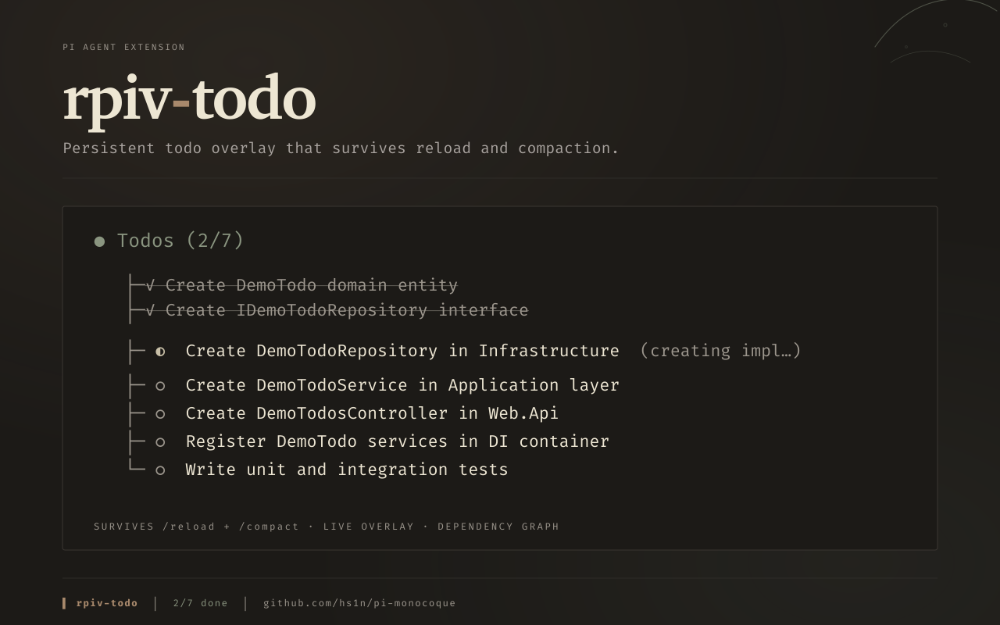

# @hs1n/rpiv-todo

<div align="center">
  <a href="https://github.com/hs1n/pi-monocoque/tree/main/packages/rpiv-todo">
    
  </a>
</div>

Give the model a task list that you can see. `rpiv-todo` adds a `todo` tool, a `/todos`
command and a live panel above the editor to [Pi Agent](https://github.com/badlogic/pi-mono).
Thus you always know what the agent does now, what it finished and what is next. The extension
rebuilds the list from the conversation, so the list stays after `/reload` and compaction. This
is useful in long research → design → implement sessions.

## Install

This package is in [`hs1n/pi-monocoque`](https://github.com/hs1n/pi-monocoque), an 11-package
monorepo. Nothing is published to npm. Install the repo as a Pi source:

```sh
pi install git:github.com/hs1n/pi-monocoque
```

Restart Pi, or run `/reload` in a running session. The `Agent` tool of the pipeline comes from
a third-party package. Install it separately:

```sh
pi install npm:@tintinweb/pi-subagents@0.26.3
```

[INSTALL-FORK.md](https://github.com/hs1n/pi-monocoque/blob/main/INSTALL-FORK.md) gives the
live-checkout install (`pi install <path>`) and `scripts/fork-pi-install.sh` (one Pi entry per package).

## Quick start

After the restart, run `/todos` to make sure that the extension is loaded. In a new session, it
shows:

```
No todos yet. Ask the agent to add some!
```

Then ask for a task with more than one step, for example "add a repository layer with tests,
and track it as todos". The model calls `todo`. The panel shows above your input box, and it
updates as the work moves:


Push `ctrl+shift+t` to collapse the panel to its heading and a one-line hint. Push it again to
expand the panel. Run `/todos` at any time to show the full list, grouped by status.

## What you get

- **The plan stays on the screen.** A panel above the editor shows each task with a status
  glyph. It also shows the label of the task in progress and a `Todos (done/total)` heading.
  You do not need to ask the agent where it is.
- **Tasks stay after `/reload` and compaction.** Each change records the full snapshot on the
  session branch, also for changes from a codemode script. The extension replays the list from
  there. It writes nothing to disk, so nothing is lost.
- **Finished work does not stay in the panel.** Completed rows stay visible for the rest of the
  turn. They go away at the start of the next turn. When the list is empty, the panel closes.
- **The overlay does not fill your terminal.** Above the row limit, it removes completed tasks
  first and shortens unfinished tasks last. It tells you what it hid, for example
  `+3 more (2 completed, 1 pending)`.
- **The agent can put work in sequence, not only list it.** The extension validates `blockedBy`
  dependencies before it writes something. It rejects ids that do not exist, deleted
  dependencies, tasks that block themselves, and cycles.
- **Parallel sessions stay separate.** The task state is keyed by session. Thus a detached
  session or a child session cannot read or overwrite the foreground list.
- **Localized UI, with no setup.** The package ships ten locales. They become active when
  [`@hs1n/rpiv-i18n`](https://github.com/hs1n/pi-monocoque/tree/main/packages/rpiv-i18n) is
  installed. Without it, all text is in English.

## Configuration

This is optional. Create `~/.config/rpiv-todo/config.json`. If you set `$XDG_CONFIG_HOME`, use
`$XDG_CONFIG_HOME/rpiv-todo/config.json`:

```json
{
  "maxWidgetLines": 8,
  "collapseKey": "alt+t"
}
```

| Setting | What it does | Default |
| --- | --- | --- |
| `maxWidgetLines` | The content rows that the overlay can use, with the heading. The minimum is `3`. It applies at the next repaint. The tool-output expansion mode of Pi shows all tasks. | `12` |
| `collapseKey` | The key that collapses and expands the panel, in Pi keybinding form (`alt+o`, `ctrl+shift+t`). Set `"off"` to register no shortcut. You must run `/reload` to change the binding. | `"ctrl+shift+t"` |
| `guidance` | Replaces the built-in instructions that tell the model when and how to use the todo list. You must run `/reload`. | _(built-ins)_ |

If the file is missing or malformed, the extension uses these defaults. `rpiv-todo` only reads
this file. It never writes one. For the full rules, see
[Configuration](https://github.com/hs1n/pi-monocoque/blob/main/packages/rpiv-todo/docs/configuration.md).

## Reference

- [`todo` tool reference](https://github.com/hs1n/pi-monocoque/blob/main/packages/rpiv-todo/docs/tool-schema.md):
  each `todo` parameter, the status machine, the response envelope and the exact error strings.
- [Configuration](https://github.com/hs1n/pi-monocoque/blob/main/packages/rpiv-todo/docs/configuration.md):
  config file resolution, option validation rules and the keybinding grammar.
- [Overlay and `/todos`](https://github.com/hs1n/pi-monocoque/blob/main/packages/rpiv-todo/docs/overlay.md):
  the overlay lifecycle, glyphs, overflow, the `/todos` output and localization.

## Requirements

- A Pi Agent host. You need no API key, no model and no native dependencies.
- An interactive session for the panel and `/todos`. Headless runs still get the `todo` tool,
  but nothing shows.
- [`@hs1n/rpiv-i18n`](https://github.com/hs1n/pi-monocoque/tree/main/packages/rpiv-i18n) is an
  optional peer. Install it for a localized UI. Without it, the UI is in English.

## Related

- [`@hs1n/rpiv-i18n`](https://github.com/hs1n/pi-monocoque/tree/main/packages/rpiv-i18n):
  localizes the UI text of this extension, and adds the `/languages` command.
- [`@hs1n/rpiv-pi`](https://github.com/hs1n/pi-monocoque/tree/main/packages/rpiv-pi): the
  umbrella package. It installs this extension with the other siblings.

## License

MIT. See [LICENSE](https://github.com/hs1n/pi-monocoque/blob/main/packages/rpiv-todo/LICENSE).
