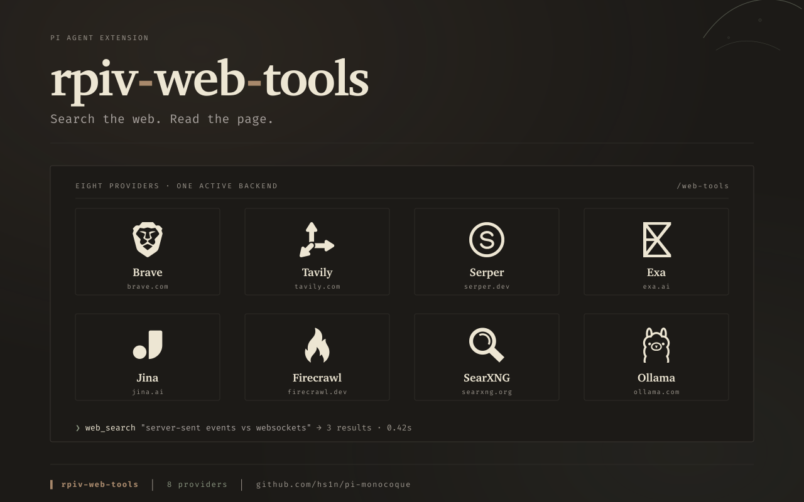

# @hs1n/rpiv-web-tools

<div align="center">
  <a href="https://github.com/hs1n/pi-monocoque/tree/main/packages/rpiv-web-tools">
    <picture>
      
    </picture>
  </a>
</div>

Let the model answer from the live web, not from its training data. `rpiv-web-tools` adds two
tools to [Pi Agent](https://github.com/badlogic/pi-mono). `web_search` sends a query to a search
API and returns titled results with URLs and snippets. `web_fetch` reads an http/https page as
text. Select one of ten backends with `/web-tools`. You can also run SearXNG or Ollama yourself,
so that your queries stay in your network.

## Install

This package is in [`hs1n/pi-monocoque`](https://github.com/hs1n/pi-monocoque), an 11-package
monorepo. Nothing is published to npm. Install the repo as a Pi source:

```sh
pi install git:github.com/hs1n/pi-monocoque
```

Restart Pi, or run `/reload` in a running session. The `Agent` tool of the pipeline comes from
a third-party package. Install it separately:

```sh
pi install npm:@tintinweb/pi-subagents@0.26.3
```

[INSTALL-FORK.md](https://github.com/hs1n/pi-monocoque/blob/main/INSTALL-FORK.md) gives the
live-checkout install (`pi install <path>`) and `scripts/fork-pi-install.sh` (one package at a time).

## Quick start

`web_search` needs credentials before it can do work. Run:

```
/web-tools
```

Select a provider from the list and paste its API key. `brave` is the default.
[Providers](https://github.com/hs1n/pi-monocoque/blob/main/packages/rpiv-web-tools/docs/providers.md)
gives the sign-up links for all ten backends. The active provider is first in the list, with
`✓`. Each provider that has credentials shows `(configured)`. For SearXNG or Ollama, the
command first asks for a base URL, because these run on your own machine.

You can also export the key of the provider and not run the command.
[Providers](https://github.com/hs1n/pi-monocoque/blob/main/packages/rpiv-web-tools/docs/providers.md)
gives the variable name for each backend:

```sh
export BRAVE_SEARCH_API_KEY=…
```

Then ask the model a question that needs current information. It calls `web_search`, and then
`web_fetch` on the useful URLs. `web_fetch` alone works with no API key.

## What you get

- **Answers from the live web**: each `web_search` call returns 1–10 titled results with URLs
  and snippets. The built-in guidance tells the model to add a `Sources:` section with
  markdown links.
- **Ten backends, one switch, and your keys stay**: Brave, Tavily, Serper, Exa, You.com, Jina,
  Firecrawl, Perplexity, SearXNG and Ollama. The extension stores one key for each provider.
  Thus a change of backend keeps all the other keys.
- **Compare backends with no config change**: give `provider` on one `web_search` call to send
  it to a different backend. There is no config write and no restart. If that backend has no
  credentials, the call fails. It does not silently use a different backend.
- **Your queries can stay in your network**: SearXNG and Ollama are full self-hosted providers.
  Each one has its own base-URL resolution and setup flow. Local Ollama needs no third-party key.
- **Large pages do not fill the context**: `web_fetch` truncates long bodies. It writes the full
  text to a temp file that the model can read when it needs it.
- **The model cannot probe your internal network**: `web_fetch` refuses protocols other than
  http(s). It also refuses private, loopback and metadata addresses.
- **GitHub links give repository content**: this is optional. When it is on, a github.com URL
  returns a file tree, a directory listing or the text of a file. The content comes from a
  cached shallow clone, not from the rendered HTML page.

## Configuration

`/web-tools` writes `~/.config/rpiv-web-tools/config.json` with mode `0600`. When
`XDG_CONFIG_HOME` is set, the directory root follows it. Run `/web-tools --show` to show the
resolved config, with the keys masked. `/web-tools` needs an interactive session.

| Key | What it does | Default |
| --- | --- | --- |
| `provider` | The active search backend | `brave` |
| `apiKeys.<provider>` | The API key of one provider | none |
| `baseUrls.<provider>` | The instance URL for `searxng` / `ollama` | provider default |
| `interceptors.github` | Turns on the GitHub URL interceptor | off |
| `guidance.<tool>` | Replaces the built-in tool guidance that the model sees | built-in text |

Environment variables have priority over the file. `WEB_SEARCH_PROVIDER` sets the active
backend. The key variable of each provider overrides `apiKeys`. For the variable names, see
[Providers](https://github.com/hs1n/pi-monocoque/blob/main/packages/rpiv-web-tools/docs/providers.md).
Provider and key changes apply on the next tool call. Guidance changes apply on the next
session start.

## Reference

- [Tool reference](https://github.com/hs1n/pi-monocoque/blob/main/packages/rpiv-web-tools/docs/tools.md):
  the `web_search` / `web_fetch` schemas, result envelopes, dispatch order, truncation and the host guard.
- [Providers](https://github.com/hs1n/pi-monocoque/blob/main/packages/rpiv-web-tools/docs/providers.md):
  the ten backends with sign-up links and key variable names. It also gives the resolution
  order for the active provider, its key and its base URL.
- [Self-hosted backends](https://github.com/hs1n/pi-monocoque/blob/main/packages/rpiv-web-tools/docs/self-hosted.md):
  SearXNG and Ollama setup, with a Docker recipe for SearXNG.
- [Configuration](https://github.com/hs1n/pi-monocoque/blob/main/packages/rpiv-web-tools/docs/configuration.md):
  each config key, failure behavior, guidance overrides and the `/web-tools --show` output.
- [GitHub URL interceptor](https://github.com/hs1n/pi-monocoque/blob/main/packages/rpiv-web-tools/docs/github-interceptor.md):
  how to turn it on, its options, the URLs that it handles and how it gets content.

## Requirements

- **Node.js 22 or newer** and a running Pi Agent host.
- **Credentials for one or more search providers** before `web_search` works. A provider with
  no key fails with `<ENV_VAR> is not set. Run /web-tools to configure, or export the env var.`
  The self-hosted providers need no vendor key. SearXNG needs an instance that you can reach,
  with `json` in `search.formats`. Ollama needs a running instance.
- **`gh` or `git`**, only for the GitHub URL interceptor. No other part of the package runs a
  shell command.

## Troubleshooting

| Symptom | Cause | Fix |
| --- | --- | --- |
| `<ENV_VAR> is not set` on each search | The resolved provider has no key | Run `/web-tools`. Or run `/web-tools --show` to see which tier set the active provider |
| SearXNG returns `403 Forbidden` | JSON output is off on the instance | Add `json` under `search.formats` in its `settings.yml`. See [self-hosted.md](https://github.com/hs1n/pi-monocoque/blob/main/packages/rpiv-web-tools/docs/self-hosted.md) |
| `Could not connect to Ollama at <host>` | No Ollama instance is at the resolved host | Start it with `ollama serve`, or set `OLLAMA_HOST` |
| `Unknown web_search provider: "…"` | A typo in `WEB_SEARCH_PROVIDER` or in the `provider` argument of the call | Use one of the ten names in [providers.md](https://github.com/hs1n/pi-monocoque/blob/main/packages/rpiv-web-tools/docs/providers.md) |
| `Unknown search provider: "…"` | A typo in `provider` in the config file | Run `/web-tools` to select again, or correct the name in `config.json` |

## Related

- [`@hs1n/rpiv-pi`](https://github.com/hs1n/pi-monocoque/tree/main/packages/rpiv-pi): the
  umbrella package. Its `web-search-researcher` agent needs these two tools.

## License

MIT. See [LICENSE](https://github.com/hs1n/pi-monocoque/blob/main/packages/rpiv-web-tools/LICENSE).
